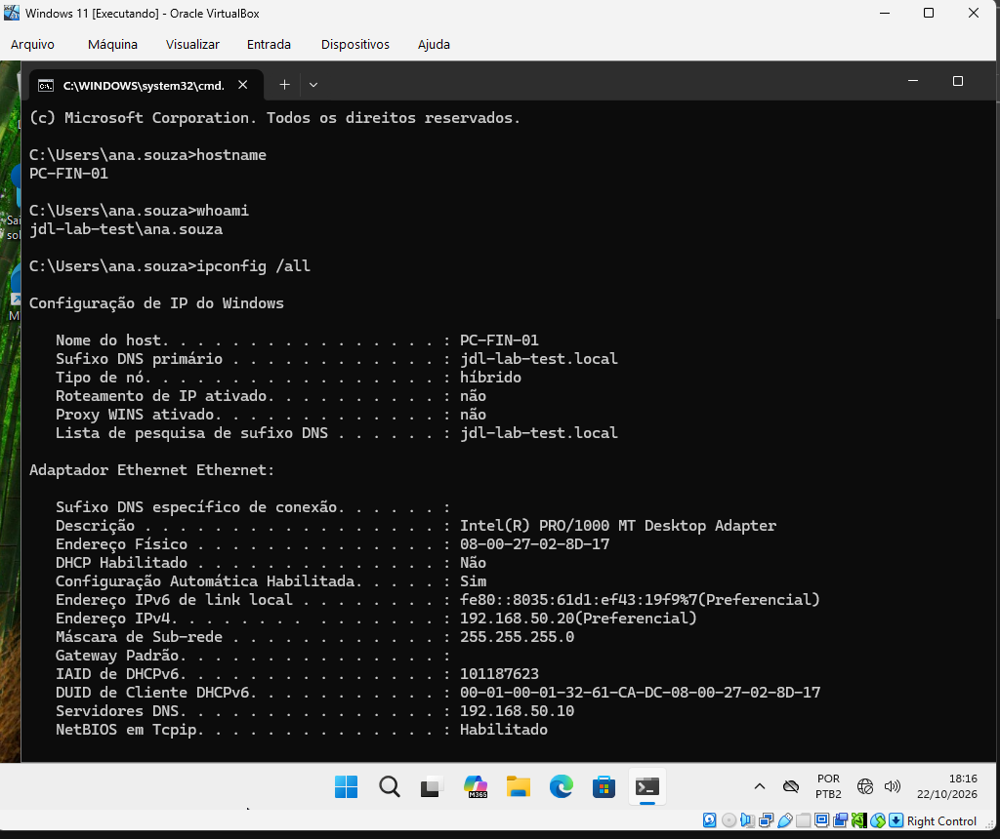
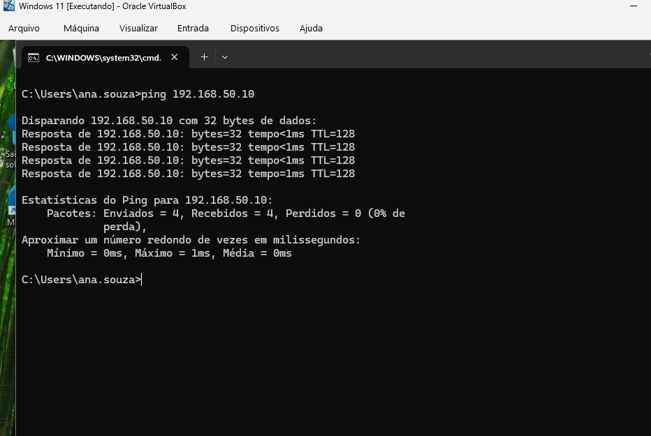
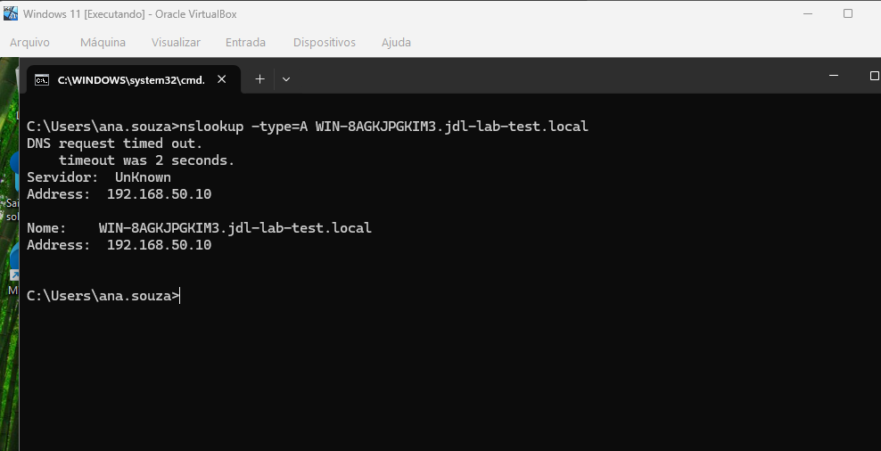
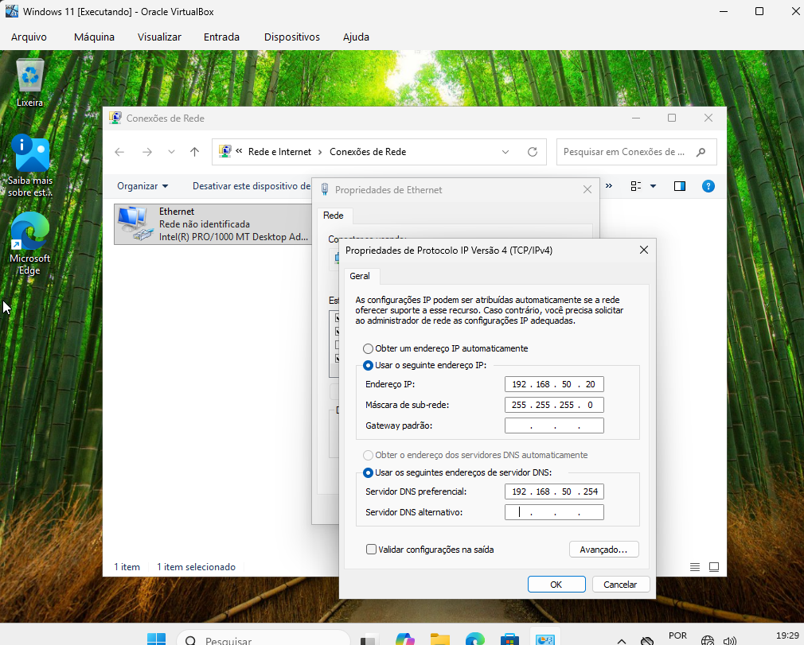
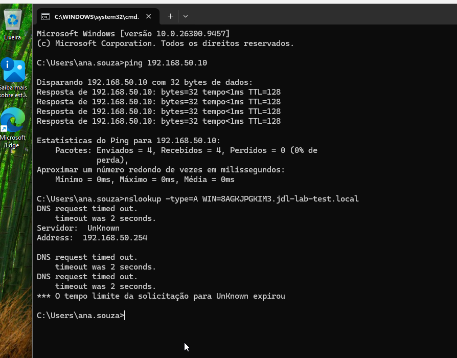
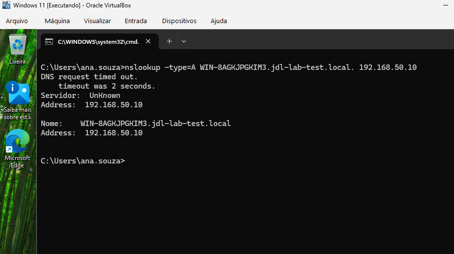
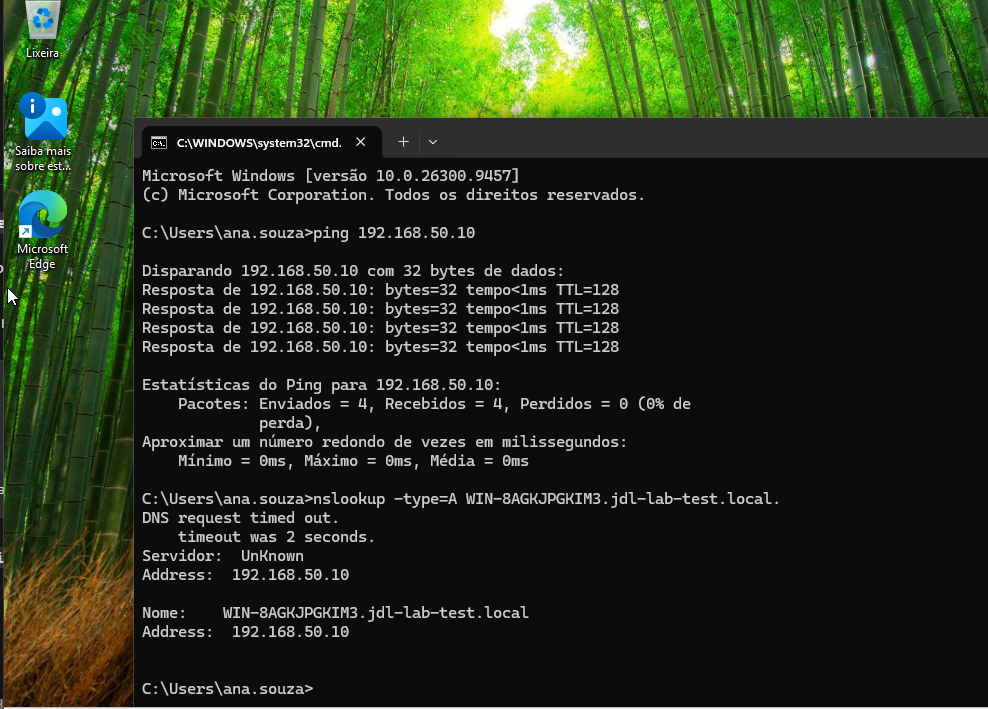

# Diagnóstico de falha de DNS no Windows

[← Laboratórios Práticos de Suporte](../README.md) · [Active Directory](../active-directory/README.md) · [Perfil](https://github.com/jardelluizoficial)

**Conectividade por IP preservada, consulta DNS sem resposta e correção no cliente.**

Prática guiada em máquinas virtuais para aprender a separar conectividade por IP de resolução de nomes. Alterei o DNS do Windows 11, comparei os testes e restaurei a configuração original.

**Autor:** Jardel Luiz · **Data:** 22/10/2026 · **Ambiente:** laboratório pessoal no Oracle VirtualBox

[Nesta página: ambiente](#ambiente) · [Passo a passo](#passo-a-passo) · [Resultados](#resultados) · [Observações](#observacoes) · [Registro do atendimento](CHAMADO.md)

## Objetivo e resultado

O DNS traduz nomes em endereços IP. Nesta prática, o cliente continuou alcançando o servidor por IP, mas deixou de obter resposta à consulta de nome quando passou a usar um endereço DNS incorreto.

**Resultado:** após restaurar o DNS preferencial de 192.168.50.254 para 192.168.50.10, a consulta voltou a retornar o endereço esperado. O aviso inicial de timeout, já presente antes da simulação, permaneceu e está descrito nas [observações](#observacoes).

## Ambiente

O exercício aproveita o cenário do [laboratório de Active Directory e Windows](../active-directory/README.md), com o servidor previamente configurado.

| Item | Configuração usada |
| --- | --- |
| Virtualização | Oracle VirtualBox; rede interna do laboratório |
| Servidor | Windows Server 2022, com Active Directory e DNS |
| Nome consultado | WIN-8AGKJPGKIM3.jdl-lab-test.local |
| IP do servidor / DNS correto | 192.168.50.10 |
| Cliente | Windows 11 — PC-FIN-01 |
| Usuária de teste | jdl-lab-test\ana.souza |
| IPv4 do cliente | 192.168.50.20 |
| Máscara do cliente | 255.255.255.0 (/24) |
| Gateway do cliente | Não configurado |
| DNS preferencial inicial e final | 192.168.50.10 |
| DNS usado para provocar a falha | 192.168.50.254 |
| DNS alternativo | Vazio |

Os testes aconteceram na mesma sub-rede. O exercício não inclui navegação na internet nem validação de serviços como compartilhamento de arquivos ou login após a falha.

## Passo a passo

Todos os comandos abaixo foram executados **na VM Windows 11**. As alterações de rede exigiram credenciais administrativas do laboratório; a conta da Ana continuou sendo usada para os testes.

### 1. Registrar a configuração inicial

No Prompt de Comando:

~~~cmd
hostname
whoami
ipconfig /all
~~~

Conferi o computador, a conta em uso, IPv4, máscara e DNS antes de alterar a configuração. O cliente tinha IP 192.168.50.20 e utilizava o DNS 192.168.50.10.

### 2. Testar a comunicação por IP

~~~cmd
ping 192.168.50.10
~~~

**Observado:** quatro pacotes enviados e quatro recebidos, sem perdas.

Esse teste confirma respostas ICMP do servidor naquele momento. Ele não verifica, por si só, se o serviço DNS está respondendo.

### 3. Consultar o nome antes da alteração

~~~cmd
nslookup -type=A WIN-8AGKJPGKIM3.jdl-lab-test.local
~~~

**Observado:** a consulta usou 192.168.50.10 e retornou o nome solicitado com o endereço 192.168.50.10. Também apareceram um timeout inicial e a identificação do servidor como UnKnown.

O parâmetro -type=A solicita o registro que associa o nome a um endereço IPv4.

### 4. Provocar a falha de forma controlada

1. Abrir Executar com Win + R e digitar ncpa.cpl.
2. Abrir **Ethernet → Propriedades → Protocolo IP Versão 4 (TCP/IPv4) → Propriedades**.
3. Autorizar a alteração com uma conta administrativa do laboratório quando solicitado.
4. Alterar somente o **Servidor DNS preferencial** para **192.168.50.254**.
5. Manter IP, máscara e gateway; deixar o DNS alternativo vazio.
6. Confirmar em **OK** nas janelas de propriedades.

A captura registra o preenchimento. O teste seguinte confirma que o endereço .254 passou a ser usado na consulta.

### 5. Comparar conectividade e resolução de nomes

~~~cmd
ping 192.168.50.10
nslookup -type=A WIN-8AGKJPGKIM3.jdl-lab-test.local
~~~

**Observado:**

- O servidor 192.168.50.10 continuou respondendo ao ping: quatro respostas e nenhuma perda.
- O nslookup passou a consultar 192.168.50.254.
- A consulta terminou por tempo limite, sem retornar o endereço do nome solicitado.

A comunicação por IP com o servidor estava preservada. A falta de resposta do DNS configurado direcionou a próxima verificação; o ping sozinho não bastaria para concluir a causa.

### 6. Consultar diretamente o DNS correto

Mantendo .254 nas propriedades do cliente, executei:

~~~cmd
nslookup -type=A WIN-8AGKJPGKIM3.jdl-lab-test.local. 192.168.50.10
~~~

O último argumento escolhe o servidor DNS para **essa consulta**, sem alterar a configuração do adaptador. O ponto após local indica um nome DNS absoluto.

**Observado:** a consulta direcionada ao .10 retornou o nome solicitado e o endereço 192.168.50.10, embora o aviso inicial continuasse aparecendo.

A comparação mostrou que o servidor correto conseguia responder à consulta testada, enquanto o endereço DNS configurado para simular a falha não respondia.

### 7. Corrigir e validar usando o DNS configurado

Nas propriedades IPv4, restaurei o **DNS preferencial para 192.168.50.10**, mantive o alternativo vazio e confirmei em **OK**.

Depois executei, sem indicar um servidor DNS no final do comando:

~~~cmd
ping 192.168.50.10
nslookup -type=A WIN-8AGKJPGKIM3.jdl-lab-test.local.
~~~

**Observado:** ping sem perdas e consulta usando novamente .10, com retorno do nome e do IP esperado. Isso valida a recuperação da consulta pelo DNS configurado no cliente.

## Comparação dos resultados

| Etapa | DNS consultado | Ping para .10 | Consulta do registro A |
| --- | --- | --- | --- |
| Antes da alteração | .10, pela configuração do cliente | 4/4 respostas | Retornou 192.168.50.10 |
| Falha controlada | .254, pela configuração do cliente | 4/4 respostas | Tempo limite; sem resposta |
| Isolamento | .10, indicado no comando | Não repetido nessa captura | Retornou 192.168.50.10 |
| Após a correção | .10, pela configuração do cliente | 4/4 respostas | Retornou 192.168.50.10 |

As consultas bem-sucedidas também exibiram um timeout inicial. O resultado da simulação é a recuperação da consulta do registro A, não a eliminação de todos os avisos do ambiente.

## Observações e limites da validação

- **Timeout inicial e UnKnown:** aparecem antes e depois da falha controlada, inclusive na consulta direta ao .10. Apesar desses avisos, as consultas ao .10 retornaram o nome e o IP esperados. A causa dos avisos não foi investigada neste exercício; não foi comprovada ausência de registro PTR nem falha do serviço DNS.
- **Sufixo do cliente:** o ipconfig /all registra jdl-lab-teste.local como sufixo DNS primário e de pesquisa. O nome efetivamente consultado e respondido foi WIN-8AGKJPGKIM3.jdl-lab-test.local. Essa diferença foi preservada nas evidências; o exercício não alterou o sufixo. Nas etapas 6 e 7, usei o nome absoluto com ponto final.
- **Escopo:** foi validada a consulta desse registro A e a comunicação ICMP com .10. Não foram testados todos os registros DNS, aplicações, autenticação ou acesso à internet.

## O que pratiquei para suporte

- Levantar a configuração antes de modificar o ambiente.
- Alterar uma variável por vez e comparar os resultados.
- Separar resposta ao ping de resposta a uma consulta DNS.
- Escolher explicitamente um servidor no nslookup para investigar a configuração do cliente.
- Restaurar a configuração e repetir o teste sem a indicação explícita do servidor.
- Registrar evidências e distinguir uma conclusão confirmada de uma hipótese.

O [registro de atendimento simulado](CHAMADO.md) reúne sintoma, diagnóstico, ação e validação em um formato curto.

---

[← Voltar aos laboratórios](../README.md) · [Laboratório de Active Directory](../active-directory/README.md) · [Perfil](https://github.com/jardelluizoficial)
